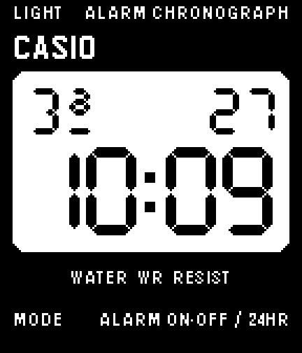
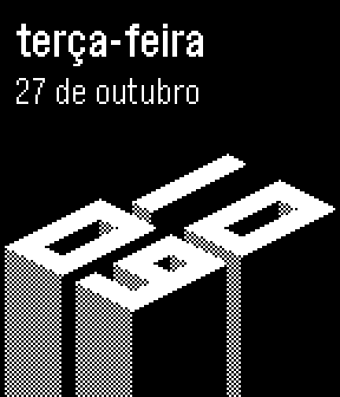
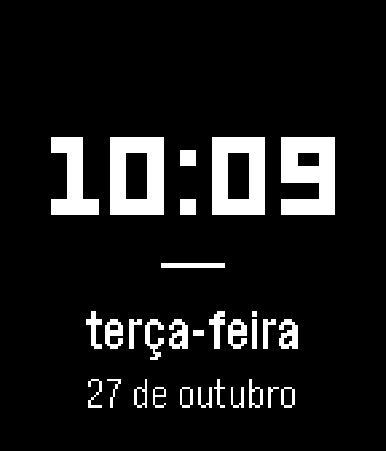
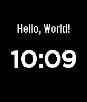

# watch-0

Learning to build watch faces for the **Pebble Core 2 Duo** (SDK platform `flint`:
144×168 black-and-white screen, 4 buttons).

## Gallery

Newest first. Screenshots come from the flint emulator and are refreshed by CI on every
merge to `main`.

| | |
| --- | --- |
|  | **[F-91W](f91w)**: a homage to the Casio F-91W. A hand-drawn segment LCD with Portuguese abbreviated weekdays (Do, 2ª, 3ª, 4ª, 5ª, 6ª, Sa), with custom "D" and "ª" glyphs in the day field like the original's own segment shapes. |
|  | **[Elevação](elevacao)**: a nod to the "Elevation" face. The time is four block digits in 2:1 isometric on one plane. Every lit cell is a solid column, so the number itself is the raised surface. Mínimo's Portuguese weekday and date sit above. |
|  | **[Mínimo](minimal-pt)**: large time, a thin rule, then the weekday and date in Portuguese ("terça-feira", "27 de outubro"). |
|  | **[Hello World](hello-world)**: "Hello, World!" plus the time, updated every minute. |

## Build locally

```bash
# Install uv (https://docs.astral.sh/uv/), then:
uv tool install pebble-tool --python 3.13
pebble sdk install latest

cd hello-world
pebble build                          # -> build/hello-world.pbw
pebble install --emulator flint       # try it in the emulator
pebble install --phone <PHONE_IP>     # send to the watch (enable Developer Connection in the Pebble app)
```

You don't need a local setup: every pull request and push to `main` runs
`.github/workflows/build.yml`, which builds each project and uploads the `.pbw` (and
emulator screenshots when they work) as a run artifact. The artifact downloads as a zip:
unzip it, then open the `.pbw` on your phone with the Pebble app to install it.
